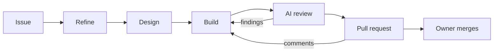

# ai-playground

A sandbox for exploring AI-assisted coding and AI automation.

## The app: credential rotation tracker

A small management app where users track credential rotations for their other applications.

It stores **metadata only**, never secrets:

- **Rotation policy**: how often a credential must be rotated, when it was last rotated, when it's due next
- **Rotation locations**: where the credential lives and must be updated (code, config files, pipelines, key vaults, etc.)
- **Owner/app**: which application and who's responsible

## Running locally

Requires Docker.

```sh
docker compose up -d --build
```

Then open http://localhost:8080.

## AI automation

The repo is built mostly by AI agents. The owner decides, the agents do the work.

### Workflow



The owner approves the spec after refine and the design before build; small fixes skip design, big items are split into sub-issues.

### Pillars

- **Issues are the work items.** Each one moves through refine, design, build and review, and the owner approves every step.
- **Skills hold the process.** Each step is a written, versioned instruction set the agent follows, so runs behave the same every time.
- **Docs hold the conventions.** The project rules and a shared domain glossary guide every agent run.
- **Automation starts the work.** Handing an issue to an agent starts a conversation thread on it, with no manual setup.
- **Work runs in parallel.** Every build is isolated, so several issues can be built at once; big items are split and built in order.

### Guard rails

- **Human gates.** The owner approves scope and design, and only the owner merges. Agents never decide on their own.
- **Protected main branch.** Changes land only through a reviewed pull request with a green CI.
- **Tests first.** Behaviour scenarios and unit tests come before the code; a change is done when the full suite, including browser tests against a real database, passes.
- **Strict static analysis.** Style, code quality, complexity limits and banned APIs are checked in the build, and any violation fails it.
- **Architecture tests.** Tests guard the domain-driven structure and the project's design rules.
- **Independent review.** A separate AI reviewer checks every change for bugs, spec match, domain design, pattern drift and reuse.
- **Limited permissions.** Agents may make the changes their process needs; irreversible actions are blocked.
- **No secrets.** The app stores rotation metadata only, never credential values.
