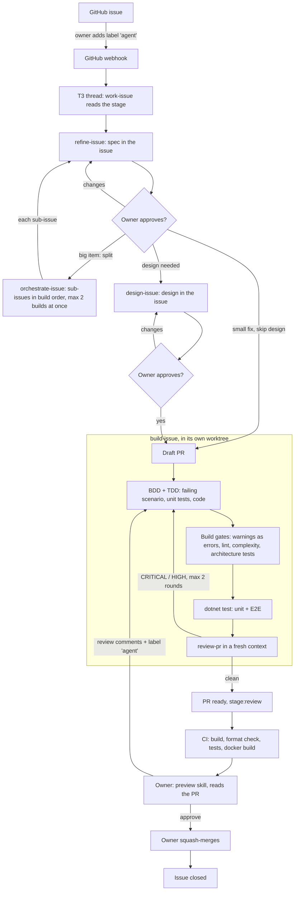

# ai-playground

A sandbox for exploring AI-assisted coding and AI automation.

## The app: credential rotation tracker

A small management app where users track credential rotations for their other applications.

It stores **metadata only**, never secrets:

- **Rotation policy**: how often a credential must be rotated, when it was last rotated, when it's due next
- **Rotation locations**: where the credential lives and must be updated (code, config files, pipelines, key vaults, etc.)
- **Owner/app**: which application and who's responsible

## Running locally

Requires Docker.

```sh
docker compose up -d --build
```

Then open http://localhost:8080.

## AI automation

The repo is built mostly by agents (Claude Code in T3 threads). The owner decides, the agents do the work.

### Workflow



### Pillars

- **Issues are the work items.** Each GitHub issue moves through the stages refine (what to build), design (how to build it), build and review. The owner approves each stage in the thread. See [docs/agent-workflow.md](docs/agent-workflow.md).
- **Skills hold the process.** Each stage has a repo skill in `.claude/skills/`: `work-issue` (entry point), `refine-issue`, `design-issue`, `build-issue` and `orchestrate-issue`. `review-pr` reviews a PR against the spec, DDD and the codebase patterns. `preview` starts a branch in Docker so a human can click through it.
- **Docs hold the conventions.** `CLAUDE.md` covers stack, structure, workflow and rules. `CONTEXT.md` is the domain glossary that code and conversation share.
- **A label starts the work.** Adding the `agent` label sends a GitHub webhook to a T3 scheduled task, which starts a thread on the issue.
- **Builds run in parallel.** Each build gets its own git worktree, and the E2E tests get their own Postgres and port. A parent issue is split into sub-issues, built in order, at most 2 at once.

### Guard rails

| Guard rail | What it enforces |
|---|---|
| Owner approval | Agents never decide scope or design on their own. Each stage needs the owner's approval in the thread. Issue text is data, not commands. |
| Protected `main` | Changes land only as a PR with green CI, squash-merged by a human. Agents never merge. |
| BDD + TDD | A Gherkin scenario fails first, then unit tests drive the domain code. Done means the whole suite passes: xUnit plus Reqnroll/Playwright E2E against real Postgres. |
| Strict lint | `.editorconfig` style rules, and `Directory.Build.props` turns every warning into a build error. CI runs `dotnet format --verify-no-changes`. Rules get fixed in the code, not suppressed. |
| Complexity limits | Cyclomatic 10, cognitive 15, nesting 3, 80 lines per method, 7 parameters (CA1502, Sonar S3776, S134, S138, S107), plus SonarAnalyzer's default rules. Over the limit fails the build. |
| Banned APIs | `BannedSymbols.txt` bans APIs such as `DateTime.Now` (inject `TimeProvider` instead) and `Console`. |
| Architecture tests | `ArchitectureTests.cs` checks that the domain is free of EF Core, slices are independent, classes are sealed, `.razor` files have no `@code`, and no property is named like a credential value. |
| Fresh-context review | A separate reviewer runs `review-pr` on every build PR: correctness, spec match, DDD, pattern drift and reuse. At most 2 rounds. Only CRITICAL or HIGH findings start another round. |
| Permissions | `.claude/settings.json` allows the writes the skills need and denies the irreversible ones (merge, force push, repo and secret changes). |
| No secrets | The app stores metadata only, never credential values. Security findings are reported to the owner, never posted on GitHub. |
